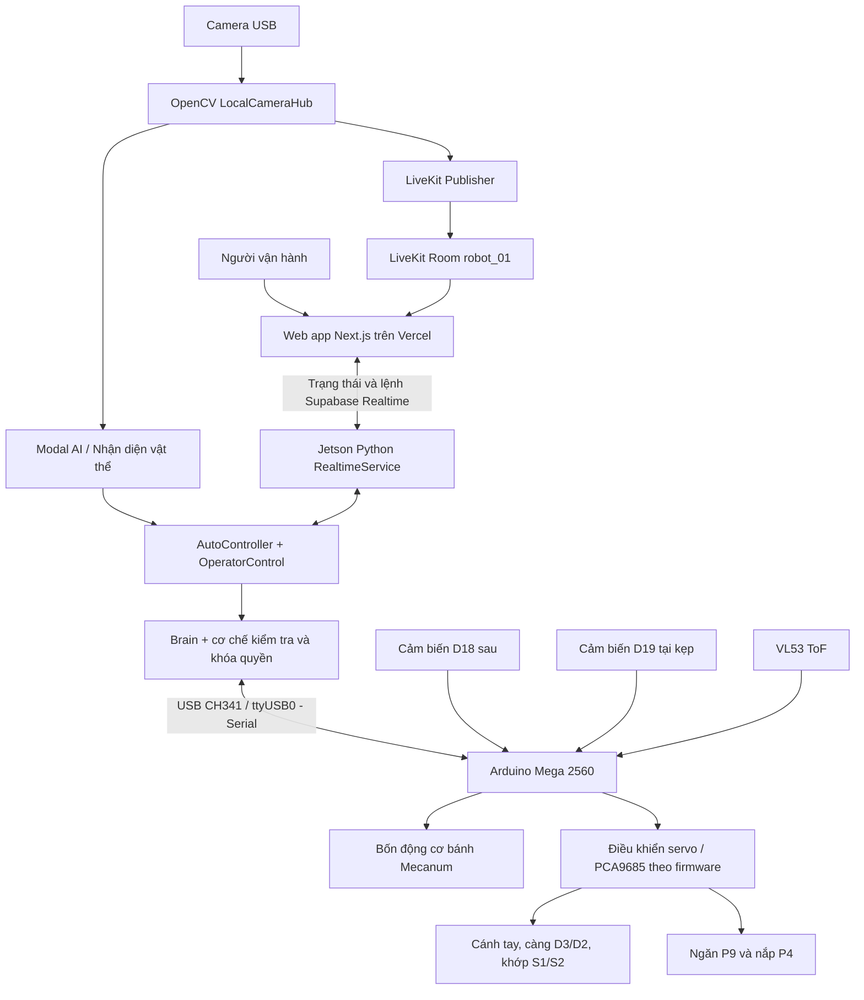
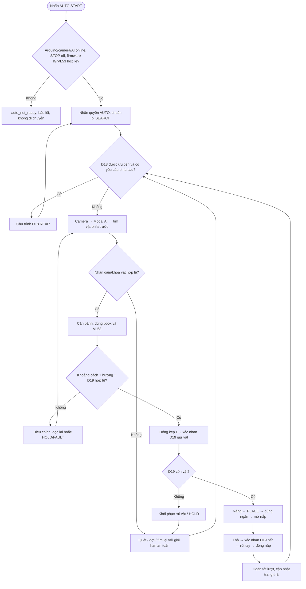
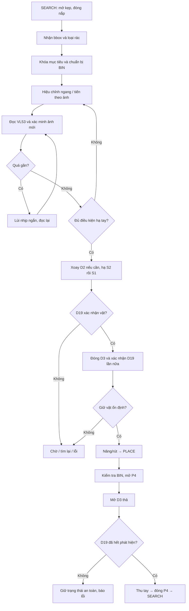
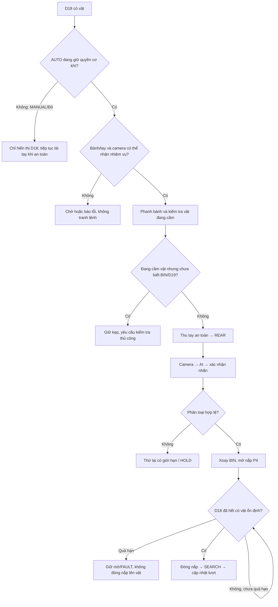
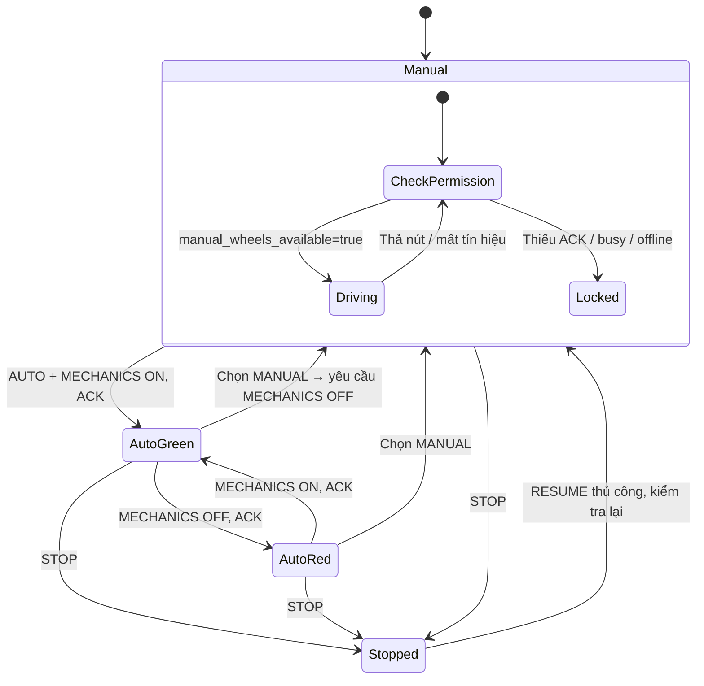
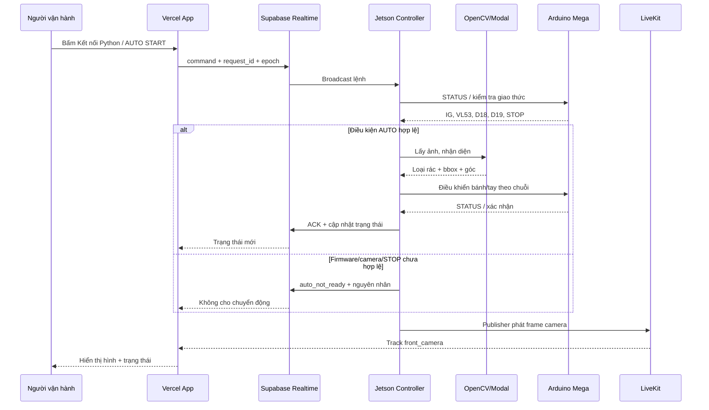

# WASTE ROBOT V3.16.37 — TÀI LIỆU KIẾN TRÚC, VẬN HÀNH VÀ QUY TRÌNH AUTO

> **Phạm vi:** đối chiếu mã nguồn trong `waste_robot_v3_16_37_d18_vercel_ig_firmware_livekit.zip` (Jetson, Arduino và thiết lập tham số) và cấu trúc app `Waste_App` đã kiểm tra. Đây là **mô tả phần mềm theo mã nguồn**, không phải chứng nhận đã kiểm nghiệm trên robot thật. Các thông số xung, thời gian và hành vi có thể bị thay đổi trong cấu hình triển khai.
>
> **Cảnh báo:** thử bánh khi robot được kê nâng khỏi mặt đất; giữ nút STOP sẵn sàng; không di chuyển robot khi cánh tay vươn ra ngoài vùng an toàn. **Không đăng `python/.env`** vì các bản ZIP cũ có thể chứa khóa LiveKit thật.

## MỤC LỤC

1. [Mục tiêu và nguyên lý](#1-mục-tiêu-và-nguyên-lý)
2. [Sơ đồ tổng thể](#2-sơ-đồ-tổng-thể)
3. [Phần cứng và phân công chân](#3-phần-cứng-và-phân-công-chân)
4. [Kiến trúc phần mềm và dữ liệu](#4-kiến-trúc-phần-mềm-và-dữ-liệu)
5. [Hướng dẫn cài đặt và chạy](#5-hướng-dẫn-cài-đặt-và-chạy)
6. [Chế độ MANUAL, AUTO và bàn giao quyền](#6-chế-độ-manual-auto-và-bàn-giao-quyền)
7. [Quy trình AUTO phía trước đầy đủ](#7-quy-trình-auto-phía-trước-đầy-đủ)
8. [Quy trình D18 phía sau](#8-quy-trình-d18-phía-sau)
9. [Các sơ đồ thuật toán](#9-các-sơ-đồ-thuật-toán)
10. [Máy trạng thái và bảo vệ an toàn](#10-máy-trạng-thái-và-bảo-vệ-an-toàn)
11. [Thông số cấu hình](#11-thông-số-cấu-hình)
12. [Chẩn đoán và xử lý lỗi](#12-chẩn-đoán-và-xử-lý-lỗi)
13. [Cách xây dựng, mở rộng và kiểm thử](#13-cách-xây-dựng-mở-rộng-và-kiểm-thử)
14. [Kiểm tra trước khi vận hành](#14-kiểm-tra-trước-khi-vận-hành)

---

## 1. Mục tiêu và nguyên lý

Waste Robot là hệ thống thu gom và phân loại rác gồm **bệ di động dùng bánh Mecanum**, **cánh tay có càng kẹp**, **thùng phân loại nhiều ngăn**, cảm biến và camera. Jetson Nano phụ trách thu hình, gọi dịch vụ AI và điều phối chu trình; Arduino Mega thực thi servo, động cơ và thu thập cảm biến. App Vercel dùng để xem camera và phát lệnh từ xa.

Hai luồng nghiệp vụ khác nhau:

- **Rác phía trước:** camera phát hiện mục tiêu → AI phân loại → robot căn vị trí, đo khoảng cách → D19 xác nhận vật ở vị trí gắp → đóng kẹp → nâng → đưa tới ngăn phù hợp → thả và quay về SEARCH.
- **Rác phía sau:** D18 kích hoạt yêu cầu nhận rác → AUTO đưa tay sang REAR, camera nhận diện → lựa chọn ngăn → mở nắp chờ vật đi qua → D18 hết phát hiện và được xác nhận → đóng nắp, đưa tay về SEARCH.

**Phân biệt:** D18 là cảm biến nhận rác phía sau, D19 là cảm biến xác nhận có vật ở khu vực càng kẹp. Chúng không thay thế nhau; D19 **không đo lực kẹp**. Cảm biến VL53 đo khoảng cách trong chu trình tiếp cận, nhưng số đo sai/thiếu không được coi là bằng chứng chắc chắn đã tới vật.

## 2. Sơ đồ tổng thể



**Ba đường truyền độc lập cần phân biệt:** (1) camera nội bộ Jetson → AI để quyết định; (2) camera Jetson → LiveKit → video trên trình duyệt; (3) Vercel ↔ Supabase ↔ Python ↔ Arduino để điều khiển. **Thấy nhãn “TRỰC TIẾP” không bảo đảm Python hoặc Arduino đã online.** Video có thể chạy trong khi các nút bánh vẫn bị khóa hợp lệ.

## 3. Phần cứng và phân công chân

| Thành phần | Nhiệm vụ | Điểm cần chú ý |
|---|---|---|
| NVIDIA Jetson Nano | Chạy Python, OpenCV, AUTO, LiveKit và điều khiển | Cần Python/môi trường đã cài đúng thư viện |
| Arduino Mega 2560 | Giao tiếp Serial; lệnh bánh, servo; phản hồi trạng thái | Cần nạp firmware cùng phiên bản, xác nhận giao thức `IG` |
| USB CH340/CH341 | Nối Jetson ↔ Arduino | Thường `/dev/ttyUSB0`; có thể thay đổi khi cắm lại |
| Camera USB UVC | Hình ảnh nhìn mục tiêu; cùng nguồn hình đưa lên web | Chỉ mở một tiến trình thu hình, sau đó phân nhánh |
| VL53 | Đo khoảng cách tới khu vực gắp | Chỉ tin mẫu hợp lệ, đúng tuổi dữ liệu |
| D19 | Có vật tại vùng gắp và kiểm tra trong lúc mang | Mức `0` được cấu hình là phát hiện |
| D18 | Nhận vật khu vực tiếp nhận phía sau | Mức `0` được cấu hình là phát hiện |
| M1–M4 | Bánh Mecanum, tiến/lùi/ngang/chéo/quay | Lệnh giữ nút phải có cơ chế hết hạn và dừng |
| P1 / S2 | Co-duỗi/hạ thân tay theo đường đi | Xung servo, không suy ra góc nếu chưa hiệu chuẩn |
| P10 / S1 | Nâng/hạ khớp tay | Kiểm tra va chạm theo tư thế |
| P11 | Xoay trụ cánh tay | Không xoay khi tay đang ở cấu hình nguy hiểm |
| D2 | Định hướng càng theo góc vật | Mốc thẳng 2100 µs, giới hạn phần mềm |
| D3 | Càng kẹp | Mở 600 µs, đóng 2300 µs |
| P9 | Xoay ngăn chứa | Khớp mã loại rác sang ngăn |
| P4 | Nắp thùng | Mở 1600 µs, đóng 500 µs |

> **Không đấu nguồn servo tải lớn trực tiếp qua nguồn Jetson hoặc USB.** Cần nguồn điện và mass chung được thiết kế đúng chuẩn; có công tắc ngắt động lực khi kiểm thử.

### Tư thế servo trong cấu hình Python

| Tư thế | P1 (S2) | P10 (S1) | P11 | D2 | Ghi chú |
|---|---:|---:|---:|---:|---|
| SETUP | 1300 | 950 | 1250 | 2100 | Đồng thời D3=600, P9=1900, P4=500 |
| SEARCH | 1300 | 950 | 1250 | 2100 | D3 mở 600 |
| PLACE | 1300 | 1750 | 1100 | 2100* | *Khi đang giữ vật, code có thể giữ góc D2 đã đo thay vì đặt lại 2100* |
| REAR | 800 | 1630 | 1300 | 500 | Tư thế nhận rác phía sau |

**Các giá trị trên là µs, không phải độ.** Khi thay cơ cấu/cánh tay phải hiệu chuẩn lại giới hạn, hành trình và vùng an toàn. Không cố sử dụng các xung ngoài hành trình thật của servo.

## 4. Kiến trúc phần mềm và dữ liệu

```text
waste_robot_complete/
├── arduino/robot_control_v3/robot_control_v3.ino  # Firmware Mega
├── python/
│   ├── main.py                   # Điểm khởi chạy
│   ├── robot_params.py           # ROBOT_CONFIG, AUTO_CONFIG
│   ├── auto_controller.py        # Chu trình trước/sau, cảm biến, phục hồi
│   ├── operator_control.py       # Bàn giao quyền AUTO/Đỏ
│   ├── brain.py                  # Giao thức điều khiển, trạng thái, chặn an toàn
│   ├── transport.py              # USB Serial
│   ├── realtime_bridge.py        # RealtimeService, lệnh/trạng thái Supabase
│   ├── camera_publisher.py       # Camera capture
│   ├── jetson_livekit_camera.py  # Phân nhánh ảnh & phát video LiveKit
│   ├── livekit_modal.py          # Giao tiếp ảnh/AI
│   ├── firmware_check.py         # Kiểm tra khả năng firmware
│   ├── auto_checkpoint.py        # Điểm khôi phục sau gián đoạn
│   └── .env                      # Cấu hình máy, TUYỆT ĐỐI KHÔNG công khai
└── README_*.md

Ứng dụng Vercel (repo riêng Waste_App):
├── app/page.tsx
├── app/components/MechanicalControl.tsx
├── app/api/livekit-token/route.ts
├── app/api/robot/configuration/route.ts
└── lib/robot-realtime.ts
```

Các tệp liệt kê là những thành phần chính, không phải toàn bộ thư mục. `main.py` nhập `RealtimeService` từ `realtime_bridge.py`.

### Luồng lệnh từ app

1. Người vận hành giữ nút bánh hoặc nhấn lệnh tại `MechanicalControl`.
2. `RobotRealtimeClient` đóng gói lệnh cùng `robot_id`, `epoch`, `request_id`, thời hạn và phiên kết nối.
3. Supabase Realtime Broadcast chuyển lệnh đến Python `RealtimeService`.
4. Python kiểm tra phiên, quyền điều khiển, trạng thái STOP/busy, rồi yêu cầu `Brain` thực thi.
5. `Brain` truyền lệnh qua Serial cho Arduino; Arduino phản hồi `STATUS`/phản hồi lệnh.
6. Python phát trạng thái và ACK về Supabase; app cập nhật chỉ báo và nút điều khiển.

Không nên dùng phản hồi **Supabase đã nhận broadcast** làm bằng chứng động cơ đã chạy: chỉ ACK từ Python/Arduino và quan sát thực tế mới cho biết bước tiếp theo.

### Luồng hình ảnh và LiveKit

- Một camera USB → OpenCV; ảnh gốc cấp cho pipeline AI.
- Luồng publisher độc lập lấy ảnh mới từ `LocalCameraHub`, phát track `front_camera` lên phòng `robot_01` qua LiveKit.
- Vercel gọi endpoint `/api/livekit-token` để cấp token **chỉ xem**, không chứa API Secret ở client.
- App đăng ký video track `front_camera` để trình chiếu. **Nếu LiveKit ngắt, camera nội bộ và điều khiển AUTO không mặc định phải dừng**, trừ khi chính nguồn camera/AI mất.
- Chỉ lưu `LIVEKIT_API_SECRET` ở môi trường server và Jetson; không đẩy lên repo hoặc ZIP công khai.

## 5. Hướng dẫn cài đặt và chạy

### 5.1 Chuẩn bị

1. Kết nối Mega, camera USB, cảm biến và nguồn điện đúng sơ đồ thực tế của robot.
2. Chọn **Arduino Mega 2560** trong Arduino IDE. Nạp `arduino/robot_control_v3/robot_control_v3.ino` của **cùng bản ZIP**.
3. Xác nhận cổng `ls /dev/ttyUSB* /dev/ttyACM*` và quyền truy cập nhóm `dialout` (nếu dùng Linux); đóng Arduino Serial Monitor trước khi chạy Python.
4. Tại `python/.env`, chỉ kiểm tra tên biến, không in ra khóa: `ARDUINO_PORT=/dev/ttyUSB0`, `APP_URL=https://waste-app-control.vercel.app`, cấu hình `LIVEKIT_*` hợp lệ nếu cần phát camera.
5. Bảo đảm Jetson có thể truy cập Vercel, Supabase, Modal và LiveKit qua mạng; mạng có thể cho video hoạt động nhưng kênh lệnh bị lỗi riêng.

### 5.2 Kiểm tra firmware **khi Python robot đang tắt**

```bash
cd /duong-dan-den/waste_robot_complete
python3 python/main.py --firmware-check
```

Tính năng kiểm tra đọc thông tin hỗ trợ, yêu cầu `drive_protocol=4`, `smooth_protocol=1`, trường `ir_drive_guard` (IG), `tof_protocol=1`, `tof_auto_continue=true`. **Nếu thiếu IG** thì nạp lại firmware; không xóa điều kiện bảo vệ trong Python.

### 5.3 Chạy máy

```bash
cd /duong-dan-den/waste_robot_complete
python3 python/main.py
```

Nếu cần chẩn đoán LiveKit:

```bash
python3 python/main.py --livekit-check
```

Mở:

- **App Internet:** `https://waste-app-control.vercel.app`
- **Giao diện nội bộ:** `http://127.0.0.1:8766/control` nếu dashboard cục bộ đã bật.

Trên app, bấm **Kết nối Python**. Chỉ thao tác cơ khí khi trạng thái Arduino báo online và còn mới (`fresh`). Sau STOP cần bấm **Cho phép điều khiển**; không tự động tiếp tục chỉ vì mạng kết nối lại.

## 6. Chế độ MANUAL, AUTO và bàn giao quyền

Có **hai lớp điều khiển khác nhau**: nhãn trang MANUAL/AUTO trên giao diện và **quyền sở hữu cơ khí trên Jetson** (`mechanics_enabled`, `manual_wheels_available`, `transitioning`). Đổi tab không tự động có nghĩa Arduino đã cấp quyền.

| Trạng thái | Camera/AI | Quyền bánh xe | Xử lý tự động D18 |
|---|---|---|---|
| MANUAL, đã bàn giao sang Đỏ | Vẫn có thể xem ảnh và quan sát | Người dùng, khi Jetson cho phép | **Không tự REAR**, không tự mở nắp |
| AUTO **Xanh – AUTO điều khiển** | Nhận diện và hành động | AUTO | D18 có thể kích hoạt REAR khi điều kiện an toàn cho phép |
| AUTO **Đỏ – Bạn điều khiển** | Có thể tiếp tục quan sát/nhận diện | Người dùng, sau ACK bàn giao | **Không tự chiếm cơ khí** |
| STOP khẩn | Video có thể còn | Khóa lệnh di chuyển | Không bắt đầu cơ cấu mới |
| Đang chuyển quyền | Theo cấu hình | Chờ, phanh/không nhận lệnh lái | Không tạo thao tác REAR mới |

**Điều kiện mở nút bánh** theo thiết kế mới: app đã kết nối Python, trạng thái robot tươi, không STOP, không busy/transitioning, `mechanics_enabled=false` và **Jetson xác nhận** `manual_wheels_available=true`. D18 phát hiện **không được tự nó đóng vai trò khóa bánh trong MANUAL**, nhưng những khóa an toàn khác vẫn có hiệu lực.

**Giữ nút để lái, thả để dừng:** app gửi lệnh nhắc lại khi giữ; lệnh `XM` dừng bánh khi thả/đổi màn hình/mất tiêu điểm. Không dùng thiết kế web này như hệ thống điều khiển an toàn độc lập; cần giới hạn timeout tại firmware và dừng khẩn cấp phần cứng.

### Lưu ý quan trọng về MANUAL + D18

**V3.16.37 KHÔNG cho MANUAL tự đưa tay về REAR, không tự phân loại vật D18.** Trong `auto_controller.py`, `service_rear()` thoát khi `mechanics_enabled=false`, nhằm bảo vệ quyền điều khiển bằng tay. Chức năng “MANUAL lái bánh nhưng cánh tay tự xử lý D18 phía sau” chỉ là **ý tưởng mở rộng**, không được ghi là đã hoạt động.

## 7. Quy trình AUTO phía trước đầy đủ

### A. Bắt đầu và kiểm tra điều kiện

1. Nhận lệnh `AUTO START`, xác nhận camera/AI và Arduino kết nối.
2. Kiểm tra STOP, busy, trạng thái giao thức điều khiển động cơ, IG/D19, giao thức VL53; nếu không đủ điều kiện đưa ra `auto_not_ready`, **không chạy liều**.
3. Nhận quyền cơ khí AUTO và thiết lập checkpoint phiên làm việc.
4. Cho phép D18 tham gia khi được bật bởi cấu hình AUTO.

### B. Chuẩn bị SEARCH

5. Hủy mục tiêu cũ, kiểm tra chưa giữ vật, xóa ảnh/khóa đối tượng cũ.
6. Đóng nắp thùng, mở kẹp, đưa S1/S2/P11/D2 về `SEARCH`.
7. Chỉ sau khi tư thế ổn định mới dùng ảnh để căn bánh. Khi đang di chuyển tay, hạn chế ra lệnh bánh gây rung/nhầm vị trí.

### C. Tìm và khóa mục tiêu

8. Camera thu khung hình mới, gửi AI/Modal và nhận danh sách đối tượng kèm nhãn, hộp bao (bbox), độ tin cậy nếu có.
9. Chọn mục tiêu hợp lệ, ánh xạ nhãn sang **RECYCLE / ORGANIC / HAZARD / OTHER**; đảm bảo có ngăn tương ứng.
10. Khóa mục tiêu (target lock), kiểm tra độ mới ảnh, thay đổi vị trí bbox và các điều kiện khớp. Theo cấu hình, có thể **chốt loại rác ngay ảnh đầu tiên ở SEARCH**, nhưng các lượt sau vẫn cần kiểm tra cùng mục tiêu để tránh nhầm vật.
11. Nếu không có vật phù hợp, dùng quy trình tìm lại/quét quay phải theo cấu hình; không tự tiến không giới hạn khi camera không thấy vật.

### D. Căn vị trí và tiếp cận

12. Từ bbox, tính sai lệch tâm ngang so với vùng gắp, sinh lệnh bánh Mecanum nhỏ (ngang/quay/tiến/lùi theo nhánh thuật toán).
13. Kiểm tra tiến triển giữa các ảnh; nếu vật biến mất, box thay đổi bất thường, hoặc vượt giới hạn thì giữ/dừng và nhận diện lại.
14. Với nhánh box/VL53, thực hiện tiến và căn theo kích thước/vị trí bbox, rồi dùng VL53 để xác nhận vùng gắp xấp xỉ **200–250 mm** (theo cấu hình hiện tại).
15. Nếu đã quá gần dưới **200 mm** trong nhánh tương ứng, có thể lùi từng nhịp khoảng **200 ms**, sau đó đo lại; số bước bị giới hạn. Khi mất đo hoặc đo lỗi, **không được suy diễn đã tới khoảng gắp**.
16. Lưu và áp dụng góc vật cho D2 khi đủ quan sát; ngưỡng xoay khoảng **10°**: dưới ngưỡng có thể giữ thẳng, trên ngưỡng xoay trong giới hạn vật lý (trái đến -90°, phải đến +60° trong mô hình phần mềm).
17. Hạ tay theo hành trình an toàn trong cấu hình: S2 có thể hạ trước khi S1 hạ; chỉ hạ S1 vào vị trí gắp sau khi vùng khoảng cách và hướng đã đủ điều kiện. Đây là **chuỗi điều kiện**, không chỉ là một lệnh đi thẳng đến xung cuối.

### E. Xác nhận gắp

18. Khi D19 có vật ở vị trí hợp lệ và khớp đúng mục tiêu/ngăn, mới cho đóng D3 tới khoảng **2300 µs**.
19. D19 phải tiếp tục báo giữ vật qua một cửa sổ xác nhận sau khi đóng, trước khi nâng. **D19 có vật trước khi đóng không chứng minh kẹp chắc sau khi đóng.**
20. Nếu rớt/mất D19, đi vào xử lý rơi vật, không tiếp tục đưa tay qua ngăn như đang giữ vật.

### F. Nâng, thả và kết thúc

21. Nâng và rút tay về quỹ đạo an toàn, duy trì D3 đóng; xác nhận D19 còn vật.
22. Chuyển tới `PLACE`, giữ góc D2 thích hợp, đảm bảo P9 trùng ngăn đã phân loại. Ngăn có thể được chuẩn bị từ sớm, **nhưng phải kiểm tra lại trước khi thả**.
23. Mở nắp P4 (nếu chưa mở); kiểm tra điều kiện giữ vật và vị trí tay.
24. Mở kẹp D3=600 µs để thả; chờ D19 xác nhận **không còn vật** ổn định. Nếu D19 vẫn báo có vật thì dừng tại vị trí thả thay vì giả định xong.
25. Rút tay về SEARCH **trước khi đóng nắp** để tránh va chạm.
26. Đóng nắp, cập nhật số lượt thành công, xóa checkpoint của lượt đã hoàn tất và tiếp tục/quay về trạng thái chờ tùy cấu hình AUTO.

### Xử lý lỗi mất vật, vật rơi

- Nếu D19 mất vật khi đang nâng/chuyển: phanh bánh, không mở kẹp tùy tiện, đánh giá gắp lại hoặc tìm lại theo trạng thái vật.
- Nhánh phục hồi được cấu hình có thể quay về SEARCH, kiểm tra camera, lùi **tối đa 10 nhịp** (xấp xỉ 400 ms/nhịp, dừng 2 giây để quan sát), rồi quét phải khi chưa thấy; cần áp dụng giới hạn theo điều kiện hiện trường.
- Nếu lặp lại thất bại, hệ thống có thể chuyển HOLD/FAULT yêu cầu kiểm tra; không coi quy trình phục hồi là đảm bảo nhặt được mọi vật.
- Nếu mất kết nối USB khi AUTO: giữ checkpoint, xác minh trạng thái khi kết nối lại; **không tự tái chạy chuyển động nguy hiểm khi tay có thể còn giữ vật**.

## 8. Quy trình D18 phía sau

**Điều kiện:** D18 được bật trong AUTO, quyền cơ khí thuộc AUTO, robot không STOP, camera/AI sẵn sàng và không có tác vụ servo xung đột. D18 phát hiện ở mức active `0`.

1. D18 được xác nhận theo cấu hình/độ ổn định cảm biến; AUTO tạo yêu cầu nhận rác phía sau.
2. Bánh dừng; nếu đang giữ vật phía trước, cần xử lý vật đang giữ **một cách xác minh được** trước khi đưa tay sang sau. Nếu kẹp đang đóng mà không xác minh được vật/BIN thì **không tự nhả**; chờ kiểm tra.
3. Thu tay qua quỹ đạo an toàn (nếu cần) rồi chuyển tư thế `REAR`.
4. Camera chụp vùng nhìn phía sau, Modal xác định loại vật. Có giới hạn số lần nhận diện; nếu không xác nhận được thì không xoay ngăn mù.
5. Xoay P9 đến ngăn phù hợp; mở P4 để nhận vật.
6. Theo dõi D18: **chỉ đóng nắp khi đã nhận D18 hết phát hiện ổn định**. Có giới hạn thời gian mở nắp; quá hạn thì giữ trạng thái lỗi an toàn, **không tự đóng lên vật**.
7. Đóng P4, chuyển tay về SEARCH, đánh dấu lượt nhận thành công và cấp trạng thái đổi quà nếu điều kiện nghiệp vụ đáp ứng.
8. AUTO có thể lùi tìm tiếp theo cấu hình `post_rear_back_steps=10`, `post_rear_back_ms=400`, `post_rear_settle_ms=2000`; chỉ sử dụng khi đường lùi được xác nhận không gây va chạm.

**Tại MANUAL/Đỏ:** D18 vẫn được đọc và hiển thị, nhưng `service_rear()` không chạy chu trình trên. Không nhầm D18 “đang phát hiện” với `AUTO_REAR` đã được cấp quyền.

## 9. Các sơ đồ thuật toán

### 9.1 Toàn bộ vòng đời AUTO



### 9.2 Chi tiết luồng gắp và thả phía trước



### 9.3 D18 — xử lý vật phía sau



### 9.4 Bàn giao quyền bánh và điều khiển trên app



## 10. Máy trạng thái và bảo vệ an toàn

| Trạng thái/sự kiện | Phản ứng hợp lệ |
|---|---|
| `auto_not_ready` | Không cho AUTO di chuyển; thông báo nguyên nhân cần khắc phục |
| `auto_search` | Tay SEARCH, tìm vật; D19 không được dùng để chặn toàn bộ khâu tìm kiếm |
| `auto_grip` | Chỉ đóng kẹp khi D19 và mục tiêu được xác minh |
| `auto_grip_check` | Kiểm tra vật còn ở kẹp trước khi nâng |
| `auto_lift` / `auto_place` | Giữ kẹp và theo dõi vật, tránh xung đột D18 |
| `auto_release` | Thả có chủ đích; đợi D19 xác nhận hết vật |
| `rear_look` / `rear_done` | Chỉ trong quyền AUTO; theo dõi D18 và an toàn tay/nắp |
| `manual_hold` | Giữ vị trí cơ khí đã xác lập, bánh dừng |
| `transitioning` | Không chấp nhận lệnh bánh tay trong lúc quyền điều khiển đổi chủ |
| `STOP` | Vô hiệu lệnh bánh/chu trình; chỉ tiếp tục theo thao tác cho phép rõ ràng |
| Serial ngắt | Trạng thái robot không còn `fresh`; nút điều khiển bị khóa và cần kết nối/kiểm tra lại |
| LiveKit ngắt | Camera trên web có thể mất, nhưng không suy ra chương trình cơ khí đã dừng |

**Không nên bỏ kiểm tra `IG` để hết lỗi.** `IG` điều phối guard D19 trên firmware. Python cần xác thực firmware báo trường `ir_drive_guard` và các đặc tính VL53 trước khi AUTO tiếp cận. Đây là điều kiện vận hành an toàn, không phải cảnh báo trang trí.

## 11. Thông số cấu hình

Các giá trị dưới đây trích từ `python/robot_params.py` trong V3.16.37, trừ khi ghi chú là cấu hình app/hệ thống:

| Tham số | Giá trị tham chiếu | Công dụng |
|---|---|---|
| Bánh `speed` mặc định AUTO | 20 PWM | Tốc độ điều khiển nhỏ khi căn |
| `move_ms` | 120 ms | Một bước điều chỉnh cơ bản |
| `settle_ms` | 500 ms | Chờ cơ cấu/ảnh ổn định |
| `contact_sensor` / `hold_sensor` | D19 / D19 | Kiểm tra vật trước/đang giữ |
| `grasp_hold_confirm_ms` | 300 ms | Cửa sổ xác nhận sau kẹp |
| VL53 vùng gắp | 200–250 mm (nhánh box) | Điều kiện vào vùng gắp |
| `rear.sensor` | D18 | Cảm biến tiếp nhận phía sau |
| `rear.active_level` | 0 | Mức phát hiện |
| `rear.max_detection_attempts` | 4 | Giới hạn thử nhận dạng |
| `rear.min_open_ms` | 1500 ms | Thời gian mở nắp tối thiểu |
| `rear.clear_confirm_ms` | 500 ms | Xác nhận D18 hết phát hiện |
| `rear.max_open_ms` | 12000 ms | Giới hạn chờ nắp mở |
| `rear.max_cycle_s` | 240 s | Giới hạn thời gian xử lý sau |
| `rear.post_rear_back_steps` | 10 | Giới hạn nhịp lùi sau REAR |
| `rear.post_rear_back_ms` | 400 ms | Nhịp lùi |
| `rear.post_rear_settle_ms` | 2000 ms | Nghỉ quan sát giữa các nhịp |
| LiveKit room / track | `robot_01` / `front_camera` | Ghép publisher và viewer |
| Cổng Serial tham chiếu | `/dev/ttyUSB0` | Mega dùng CH341 trên Jetson |

**Nguyên tắc hiệu chuẩn:** giá trị hiện tại là điểm khởi đầu phần mềm, không phải thông số an toàn được nhà sản xuất cơ cấu phê duyệt. Thử từng servo/bánh với tốc độ thấp; điều chỉnh giới hạn theo đúng cơ cấu và lưu bản sao cấu hình.

## 12. Chẩn đoán và xử lý lỗi

### Camera báo TRỰC TIẾP nhưng nút bánh xám

Nguyên nhân có thể là LiveKit online nhưng Supabase/Python/Arduino chưa online hoặc chưa ACK quyền lái; robot đang STOP/busy; dữ liệu cũ; hoặc máy Jetson chạy mã cũ không xuất `manual_wheels_available`.

**Quy trình:** kiểm tra Terminal Jetson → app bấm Kết nối Python → kiểm tra nhãn online/fresh → chuyển MANUAL hoặc AUTO Đỏ → xác nhận `manual_wheels_available=true` → chỉ sau đó mới kiểm tra nút bánh. **Không bỏ khóa trên giao diện để giả lập trạng thái đã được phép lái.**

### `AUTO · auto_not_ready · Cần nạp firmware ... IG`

Lý do: Python chưa nhận xác nhận `ir_drive_guard` từ firmware Mega. Dừng `main.py`, đóng Serial Monitor, kiểm tra bằng `--firmware-check`; nếu thiếu trường, nạp firmware cùng ZIP. Cũng có thể do cổng Serial nhầm, firmware cũ hoặc trạng thái chưa cập nhật.

### `/dev/ttyACM0` không tồn tại

Mega clone CH341 thường xuất hiện `/dev/ttyUSB0`; kiểm tra bằng `ls -l /dev/ttyUSB* /dev/ttyACM*`. Khi hệ thống có nhiều Serial USB, phải định danh đúng thiết bị. Không thay cổng Arduino khi Python đang giữ Serial.

### LiveKit không phát hình trên Vercel

Kiểm tra `LIVEKIT_URL` bắt đầu `wss://`, khóa server còn hiệu lực, `LIVEKIT_ROOM` đúng `robot_01`, track `front_camera`, SDK cài đúng trên Jetson, app API token hoạt động, camera USB được OpenCV mở thành công. Chỉ công bố thông báo đã kết nối khi thật sự publish track; **không hiển thị API Secret** trong log/screenshot.

### AUTO không tìm thấy vật / mất mục tiêu

Kiểm tra camera, ánh sáng, bbox mới, API Modal, phân loại nhãn→BIN, giới hạn thời gian nhận diện, VL53 và D19. Nếu phải hiệu chuẩn vùng nhìn của camera, làm trước khi tăng tốc độ bánh. Không tự tạo dữ liệu nhận diện giả để cho robot tiến tiếp.

### D18 có vật ở MANUAL nhưng tay không xoay ra sau

**Đó là hành vi hiện tại theo thiết kế**; muốn “tay tự REAR trong khi bánh vẫn điều khiển tay” cần xây dựng một bộ phân quyền riêng cho cánh tay, kiểm tra hành lang va chạm và cơ chế tạm khóa bánh khi tay xoay; hiện chưa có trong V3.16.37.

## 13. Cách xây dựng, mở rộng và kiểm thử

### 13.1 Các tầng kiến trúc và trách nhiệm

1. **Tầng vật lý:** cảm biến, camera, servo, bánh, công tắc dừng và nguồn điện; ghi rõ nguồn cấp và sơ đồ dây thực tế.
2. **Tầng firmware Arduino:** đọc cảm biến, timeout bánh, giao thức phản hồi, các lệnh dừng và giới hạn động lực.
3. **Tầng HAL/Brain Python:** bóc tách trạng thái Serial, `epoch`, kiểm tra ACK, owner và interlock; đây là nơi thẩm quyền cuối về lệnh.
4. **Tầng điều khiển trạng thái:** `AutoController`, `OperatorControl`, checkpoint và xử lý nhánh D18.
5. **Tầng thị giác AI:** một nguồn camera, ảnh gốc phân tích; mọi quyết định cần xác thực đối tượng và thời gian nhận mẫu.
6. **Tầng thời gian thực:** Supabase để truyền lệnh trạng thái, LiveKit cho video; hai mạng không thay thế nhau.
7. **Tầng UX:** app Vercel hiển thị trạng thái tươi/cũ, quyền điều khiển, lỗi cụ thể và STOP; tránh cho nút sáng chỉ vì camera online.

### 13.2 Thiết kế logic theo state machine

Mỗi bước chuyển động cần quy định: **điều kiện vào**, **lệnh**, **ACK xác nhận**, **giới hạn thời gian**, **hành vi lỗi** và **trạng thái phục hồi**. Ví dụ thao tác đóng kẹp: chỉ vào khi D19 xác nhận + mục tiêu/BIN hợp lệ; lệnh D3 đóng; kiểm tra D19 sau đóng; nếu mất vật thì dừng chu trình nâng và gọi phục hồi.

### 13.3 Quy tắc bàn giao điều khiển

- **AUTO xanh:** AUTO có quyền điều khiển bánh/tay trong các bước được phép.
- **MANUAL/Đỏ:** Jetson phanh và thu hồi quyền lái từ AUTO, đợi ACK, rồi trả `manual_wheels_available=true` khi an toàn.
- **Không có hai bên đồng thời điều khiển cùng động cơ hoặc servo.** Mọi lệnh đều có quyền sở hữu, thế hệ (`epoch`) và khả năng hủy khi STOP.
- **D18 báo có vật không phải lỗi bánh**, nhưng tay ở REAR hoặc có nguy cơ chạm đất thì vẫn có thể cần hạn chế di chuyển theo interlock cơ khí độc lập.

### 13.4 Kiểm thử theo thứ tự

1. Unit test: ánh xạ nhãn→BIN, giới hạn D2, tính bbox, mức D18/D19, kiểm tra dữ liệu ToF sai.
2. Mock Serial: ACK đúng/sai, firmware thiếu IG, USB mất kết nối, lệnh trễ và trạng thái cũ.
3. Test quyền: AUTO xanh → Đỏ; D18=0; gửi DRIVE hợp lệ; STOP; chuyển quyền giữa chu trình.
4. Test camera: OpenCV thu đúng hình; AI nhận ảnh mới; LiveKit publish không chặn pipeline AUTO.
5. Test cơ khí **không tải, nâng bánh khỏi sàn**: lần lượt M1–M4, từng servo, nắp, khớp kẹp.
6. Test AUTO thật tốc độ thấp, vùng thử kín, có giám sát viên và nút ngắt điện động lực.
7. Test lỗi: vật rơi, D19 kẹt mức 0, D18 không nhả, mất mạng, mất USB, camera sai, VL53 timeout.

### 13.5 Đề xuất mở rộng nếu muốn MANUAL vẫn tự xử lý D18

Thiết kế thêm **quyền sở hữu từng cơ cấu** (wheels / arm / bin / lid), không chỉ một cờ cơ khí chung. Khi D18 phát hiện trong MANUAL: bộ điều phối yêu cầu người lái xác nhận hoặc tự thực hiện chu trình REAR chỉ khi robot đứng yên và vùng quanh tay an toàn; khóa bánh trong thời gian xoay; cho phép khôi phục lái khi tay đã trở về tư thế an toàn. Đây là **đề xuất thiết kế tương lai**, không phải tính năng đã triển khai.

## 14. Kiểm tra trước khi vận hành

- [ ] Nguồn servo/động cơ, mass và nút ngắt khẩn cấp đã kiểm tra.
- [ ] Bánh nâng khỏi sàn khi thử lệnh lần đầu.
- [ ] Arduino Mega nhận cổng `/dev/ttyUSB0` hoặc cổng đúng của thiết bị.
- [ ] `--firmware-check` xác nhận hỗ trợ `IG`, VL53 và protocol.
- [ ] Python Jetson chạy, Supabase online, app nhận trạng thái **mới**.
- [ ] Camera OpenCV cho ảnh mới, Modal trả về đối tượng thật.
- [ ] LiveKit phát video đúng phòng/track nếu cần giám sát Internet.
- [ ] Thử STOP và thả nút bánh; xác nhận bánh dừng ngay.
- [ ] MANUAL/Đỏ: bánh chỉ mở khi quyền lái đã được Jetson xác nhận.
- [ ] AUTO xanh: D18, D19 và VL53 đã được thử riêng.
- [ ] Cánh tay không va chạm bánh/thùng/sàn ở toàn bộ quỹ đạo.
- [ ] Có người trực tiếp giám sát lúc vận hành thử AUTO.

---

## Phụ lục — Sơ đồ một lượt xử lý và ACK



**Kết luận:** Waste Robot dùng kiến trúc **Jetson xử lý thông minh – Arduino thực thi cơ khí – Supabase truyền lệnh – LiveKit truyền video – Vercel hiển thị và điều khiển**. Chu trình AUTO phía trước yêu cầu xác nhận bằng ảnh, VL53 và D19 trước khi gắp/thả; nhánh AUTO phía sau sử dụng D18 và tư thế REAR. Ở MANUAL/Đỏ, D18 chỉ được theo dõi và không tự chiếm bánh/tay. Mọi bước có rủi ro phải phụ thuộc ACK và khóa an toàn thực, không chỉ giao diện web.
